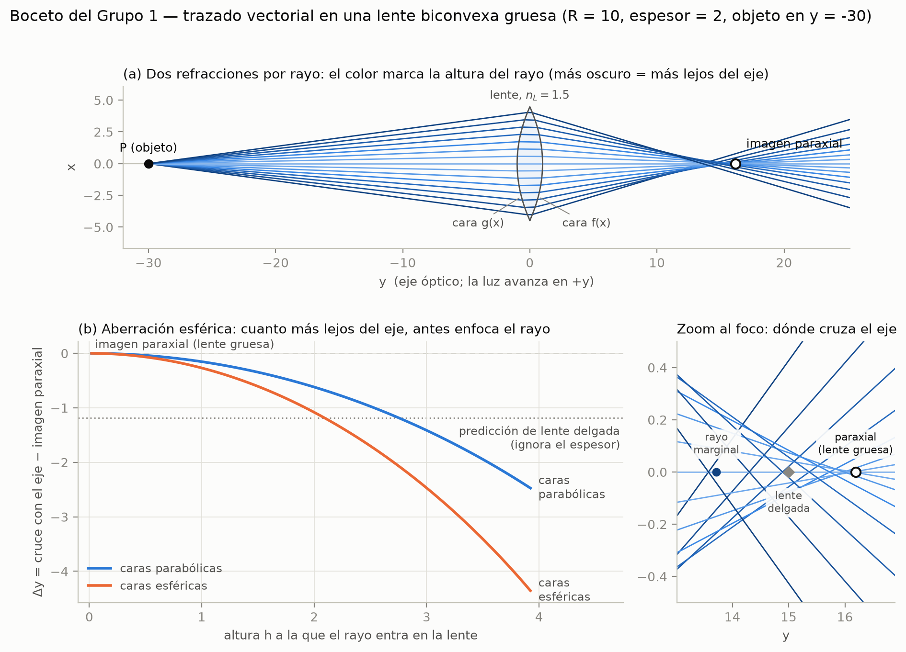

# Formación de imágenes en lentes reales mediante el análisis vectorial de rayos

[](https://github.com/oswaldoaqm/Proyecto-Opticas/actions/workflows/ci.yml)

Proyecto académico del curso **Óptica & Ondas** · UTEC, 2026-2 · **Grupo 1**  
Profesores: Marco Cuyubamba y Eduardo Castillo



**Simulación interactiva:** <https://oswaldoaqm.github.io/Proyecto-Opticas/> (también en el [notebook 03](notebooks/03_simulacion.ipynb)).

En una lente real (gruesa) cada rayo se refracta dos veces y la ecuación de lente delgada deja de ser exacta. Aquí seguimos cada rayo con vectores: la recta $\mathbf L(\lambda) = \mathbf P_0 + \lambda\hat{\mathbf u}$, su intersección con cada cara curva, la normal local y la **ley de Snell en forma vectorial**. La imagen es el cruce de los rayos emergentes. Así medimos cuánto se aparta una lente real de la predicción paraxial y por qué: por su **espesor** y por la **aberración esférica**.

## Reproducir todo

Necesitas Git y [conda](https://docs.conda.io/) (Miniconda o Anaconda) o un Python 3.12. Los comandos son para **Git Bash** en Windows y funcionan igual en Linux y macOS.

```bash
git clone https://github.com/oswaldoaqm/Proyecto-Opticas.git
cd Proyecto-Opticas
conda env create -f environment.yml    # crea el entorno "optica-grupo1" (solo la primera vez)
conda activate optica-grupo1
pytest                                  # pruebas de la física: todas deben pasar
python scripts/generar_figuras.py       # regenera todas las figuras en figuras/
jupyter lab                             # abre los notebooks
```

Si `conda activate` no funciona en Git Bash, ejecuta una vez `conda init bash` y abre otra terminal (o usa Anaconda Prompt).

La prueba de la página web (`tests/test_web.py`) necesita [Node.js](https://nodejs.org/); si no está instalado, esa prueba se omite. La página se abre sin servidor: `web/index.html`.

<details>
<summary>Sin conda (venv + pip)</summary>

```bash
py -3.12 -m venv .venv                  # Linux/macOS: python3.12 -m venv .venv
source .venv/Scripts/activate           # Linux/macOS: source .venv/bin/activate
pip install -r requirements.txt
pip install -e .
```
</details>

## Estructura

```
├── src/lentes/        núcleo: caras, lente, trazado vectorial, paraxial, aberraciones, difracción, simulación
├── tests/             pruebas de la física contra resultados conocidos
├── scripts/           generar_figuras.py: regenera todas las figuras
├── notebooks/         ejemplo resuelto, aberraciones, simulación con controles y frente de onda
├── web/               la simulación como página web (GitHub Pages)
├── figuras/           figuras generadas (PNG y SVG); no se editan a mano
├── docs/
│   ├── deduccion.md   la deducción del método vectorial (actividades 1 y 2)
│   ├── aberraciones.md  paraxial frente a vectorial, aberración esférica (4 y 5) y difracción
│   ├── simulacion.md  la simulación interactiva (actividad 6)
│   ├── enunciado.md   lo que pide el curso y la matriz de cumplimiento
│   ├── plan.md        hitos de las tres semanas y extras
│   ├── bitacora.md    registro de avances
│   └── decisiones/    por qué el proyecto es como es (una decisión por archivo)
├── poster/            fuente y exportaciones del póster
├── requirements.txt   versiones exactas de las dependencias
├── environment.yml    entorno conda (usa requirements.txt)
└── pyproject.toml     paquete lentes y configuración de pytest
```

## Convenciones

- **El eje óptico es el eje $y$** y la luz viaja en $+y$. $g(x)$ es la cara de abajo (la primera que toca la luz) y $f(x)$ la de arriba. En las figuras la vista se gira para que la luz vaya de izquierda a derecha. → [decisión 0001](docs/decisiones/0001-eje-optico-y-sentido-de-la-luz.md)
- En cada refracción la normal se orienta **hacia el medio de donde viene la luz** ($\hat n\cdot\hat u < 0$). → [decisión 0002](docs/decisiones/0002-normal-y-snell-vectorial.md)
- Longitudes en unidades arbitrarias (pueden leerse como mm); índice del aire igual a 1.
- Las figuras solo se generan con código. → [decisión 0005](docs/decisiones/0005-figuras-solo-por-codigo.md)
- Todo resultado se valida contra un límite analítico con pruebas automáticas. → [decisión 0006](docs/decisiones/0006-validar-contra-teoria.md)

## Cómo trabajamos

- Una rama por tarea y pull request a `main`; se fusiona con el CI en verde.
- Commits en español con [Conventional Commits](https://www.conventionalcommits.org/es/v1.0.0/): `tipo: descripcion`, en minúsculas, sin tildes ni ñ y sin punto final. Ejemplo: `feat: agrega diagrama de manchas`.
- Antes de subir cambios: `pytest` y `python scripts/generar_figuras.py`.
- Toda decisión que cambie el modelo o las convenciones se escribe en [`docs/decisiones/`](docs/decisiones/).

## Estado

- Deducción del método vectorial: [`docs/deduccion.md`](docs/deduccion.md)
- Ejemplo resuelto con dos puntos objeto: [`notebooks/01_ejemplo_resuelto.ipynb`](notebooks/01_ejemplo_resuelto.ipynb)
- Paraxial frente a vectorial y aberración esférica: [`docs/aberraciones.md`](docs/aberraciones.md)
- Frente de onda y límite de difracción (extra 5): [`docs/aberraciones.md`](docs/aberraciones.md), sección 5, y [`notebooks/04_frente_de_onda.ipynb`](notebooks/04_frente_de_onda.ipynb)
- Simulación interactiva: [`docs/simulacion.md`](docs/simulacion.md), [página web](https://oswaldoaqm.github.io/Proyecto-Opticas/) y [`notebooks/03_simulacion.ipynb`](notebooks/03_simulacion.ipynb)
- Póster A0 sobre la plantilla de UTEC (borrador): [`poster/`](poster/)
- Qué pide el curso y qué está cubierto: [`docs/enunciado.md`](docs/enunciado.md)
- Plan y extras: [`docs/plan.md`](docs/plan.md)
- Avances: [`docs/bitacora.md`](docs/bitacora.md)

## Límites y trabajo futuro

Lo que el modelo deja afuera a propósito, y cómo seguiría el proyecto:

| Límite | Cómo seguir |
|---|---|
| Rayos en el plano del dibujo (meridionales): fuera del eje se obtiene la imagen tangencial | Trazar en 3D, con rayos fuera del plano. La ley de Snell vectorial ya vale en 3D; daría el astigmatismo, la curvatura de campo y la coma completa. |
| Luz de un solo color | El índice como función de la longitud de onda (ecuación de Sellmeier de un vidrio real, por ejemplo BK7): aberración cromática y un doblete acromático. |
| Sin pérdidas por reflexión | Coeficientes de Fresnel en cada cara, para pesar cada rayo con la energía que transmite. |
| Caras $y = f(x)$, borde de espesor cero y diafragma en la cara $g$ | Caras paramétricas, un borde con espesor y el diafragma en otra posición. |
| Validación contra teoría, no contra un experimento | Una prueba de Hartmann: un láser, una lupa y una máscara con agujeros a distintas alturas; medir dónde cruza cada haz y compararlo con la curva $\Delta y(h)$. Y la misma lente en un programa profesional de diseño óptico. |
| Difracción escalar, objeto puntual; longitudes en mm solo en el extra 5 | Difracción vectorial para aperturas grandes y una escena con objetos extendidos. |

## Equipo

Diego Gabriel Atoche Rodriguez · Angel Manuel Farro Jurado · Fernando André Guillén Rodriguez · Oswaldo Alejandro Quispe Monzón

## Licencia

Código bajo licencia [MIT](LICENSE).
