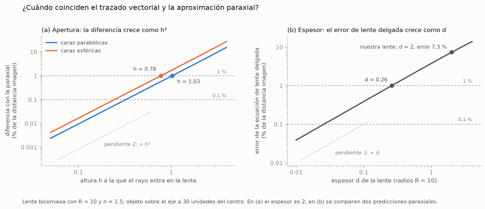
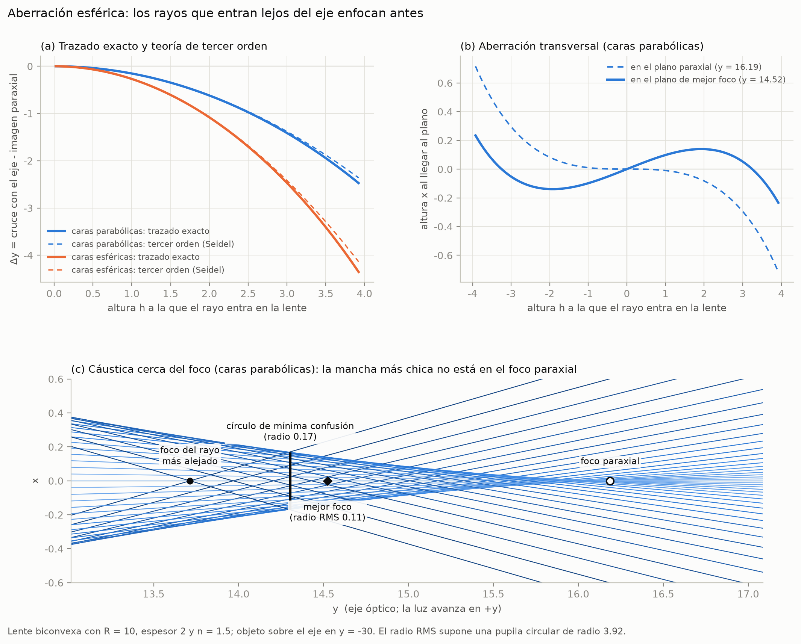
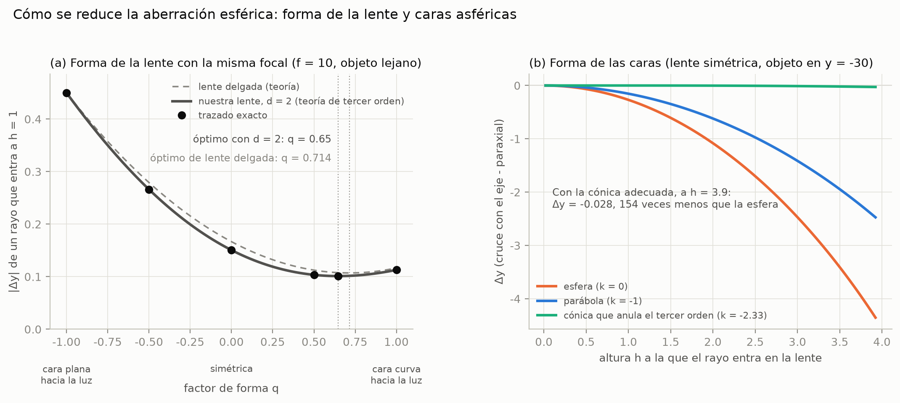

# Paraxial frente a vectorial y aberración esférica

Actividades 4 y 5 (entregables E5 y E6) y dos extras. Los números salen del [notebook 02](../notebooks/02_aberraciones.ipynb) y las figuras de `scripts/generar_figuras.py`.

Lente de trabajo: biconvexa simétrica, radios de vértice $R = 10$, espesor $2$, $n_L = 1.5$, objeto sobre el eje en $y = -30$. La comparamos con caras parabólicas ($k = -1$) y esféricas ($k = 0$). Las dos tienen la misma imagen paraxial, $y = 16.187$, porque solo cuenta la curvatura en el vértice.

## 1. Tres predicciones de la imagen

- **Trazado vectorial**: sigue cada rayo con la ley de Snell exacta ([deducción](deduccion.md)).
- **Paraxial de lente gruesa**: matrices ABCD. Tiene en cuenta el espesor, pero supone rayos cerca del eje ($\sin\theta \approx \theta$).
- **Lente delgada**: $1/s + 1/s' = 1/f$. Supone además espesor cero.

## 2. ¿Cuándo coinciden? (actividad 4)



**Apertura.** La diferencia entre el trazado y la paraxial crece como $h^2$, donde $h$ es la altura a la que el rayo entra en la lente: $\Delta y \approx C_3 h^2$, con $C_3 = -0.153$ (caras parabólicas) y $C_3 = -0.269$ (esféricas).

| Caras | Diferencia de 0.1 % | Diferencia de 1 % | En el borde ($h = 3.92$) |
|---|---|---|---|
| Parabólicas | $h = 0.32$ | $h = 1.03$ ($h/R = 0.10$) | 15.3 % |
| Esféricas | $h = 0.25$ | $h = 0.78$ ($h/R = 0.08$) | 26.9 % |

**Espesor.** La ecuación de lente delgada se equivoca en proporción al espesor $d$. Con $R = 10$ el error llega al 1 % con $d = 0.26$ ($d/R = 0.026$). Nuestra lente, con $d = 2$, tiene un error de 7.3 %.

**Conclusión.** Las predicciones coinciden cuando los rayos pasan cerca del eje ($h \ll R$) y, para la ecuación de lente delgada, cuando además $d \ll R$. Las diferencias se vuelven apreciables con lentes abiertas (rayos a una décima del radio ya dan 1 %) y con lentes gruesas. Para un objeto fuera del eje aparecen además diferencias que crecen como $x_P^2$ a lo largo del eje y como $x_P^3$ en altura (`tests/test_trazado.py`).

## 3. Aberración esférica (actividad 5)



**Qué pasa.** Los rayos que entran más lejos del eje cruzan el eje antes. Con las caras parabólicas, el rayo que entra a $h = 3.92$ cruza en $y = 13.71$, 2.5 unidades antes que la imagen paraxial.

**Por qué.** La aproximación paraxial usa $n_1\theta_i = n_2\theta_t$. La ley exacta, $n_1\sin\theta_i = n_2\sin\theta_t$, da con ángulos grandes una desviación mayor, tanto al entrar al vidrio como al salir: desarrollando, $\theta_t = \eta\theta_i + \eta(\eta^2-1)\theta_i^3/6 + \dots$ con $\eta = n_1/n_2$, y el término cúbico siempre aumenta la desviación. Lejos del eje los ángulos de incidencia son mayores, así que cada cara se comporta como si fuera un poco más potente en el borde que en el centro, y los rayos del borde enfocan antes.

**Teoría de tercer orden.** La suma de Seidel predice $C_3$ usando solo un rayo paraxial:

```math
S_I = \sum_j \left[-A_j^2\,h_j\left(\frac{u_j'}{n_j'} - \frac{u_j}{n_j}\right) + k_j\,c_j^3\,h_j^4\,(n_j' - n_j)\right],\qquad A_j = n_j\,(h_j c_j + u_j),\qquad \Delta y = -\frac{S_I}{2\,n_k' u_k'^2},
```

con $u = dh/dz$ la pendiente del rayo paraxial y $c = 1/R$. El segundo término es el aporte de la forma cónica. En ocho lentes distintas (caras esféricas, parabólicas, elípticas e hiperbólicas, objeto cercano o en el infinito) el $C_3$ del trazado y el de Seidel coinciden con una diferencia relativa de $10^{-9}$ (notebook 02, sección 1). Para $h$ grande el trazado se separa de la curva $C_3 h^2$ por los términos de orden superior (fig03 a).

**La mancha y el mejor foco.** En el plano paraxial, la altura a la que llega cada rayo crece como $h^3$ (fig03 b). No hay un punto donde se crucen todos: los rayos forman una cáustica (fig03 c). Con la pupila completa ($h \le 3.92$) y caras parabólicas:

| Plano | $y$ | Radio de la mancha |
|---|---|---|
| Foco paraxial | 16.187 | RMS 0.344 |
| Mejor foco (RMS mínimo) | 14.523 | RMS 0.113 |
| Círculo de mínima confusión | 14.303 | máximo 0.169 |
| Foco del rayo más alejado | 13.714 | |

La mancha más chica está lejos del foco paraxial y es tres veces menor que en él. Con aberración de tercer orden pura, la teoría ubica el mejor foco a $2/3$ del camino entre el foco paraxial y el del rayo más alejado, y el círculo de mínima confusión a $3/4$. Con una pupila pequeña el trazado da 0.667 y 0.748; con la completa, 0.673 y 0.762, por los términos de orden superior.

Como la lente tiene simetría de revolución, un rayo que entra a la distancia $\rho$ del eje llega a la distancia $|x(\rho)|$ del eje. Por eso el trazado en el plano basta para calcular la mancha en 3D, pesando cada anillo de la pupila en proporción a $\rho$.

**Esféricas frente a parabólicas.** Con la misma imagen paraxial, las caras esféricas aberran 75 % más ($C_3 = -0.269$ contra $-0.153$). La aberración depende de la forma de la cara lejos del eje, no solo de su curvatura en el vértice.

## 4. Cómo se reduce



**Forma de la lente.** Con la misma focal ($f = 10$, objeto lejano) se puede repartir la curvatura entre las dos caras. El factor de forma es $q = (c_1 + c_2)/(c_1 - c_2)$.

| Forma | $q$ | $\lvert C_3 \rvert$ |
|---|---|---|
| Cara plana hacia la luz | -1 | 0.450 |
| Simétrica | 0 | 0.151 |
| Óptima | 0.648 | 0.101 |
| Cara curva hacia la luz | 1 | 0.113 |

La mejor forma aberra 4.5 veces menos que la peor, con la misma focal. Si el espesor tiende a cero, el óptimo tiende a $q = 2(n^2-1)/(n+2) = 0.714$, el valor clásico de lente delgada; nuestro código lo recupera (`tests/test_seidel.py`). Regla práctica: la cara más curva hacia la luz que llega paralela.

**Caras cónicas.** $S_I$ depende linealmente de $k$, así que se puede despejar el $k$ que lo anula: $k = -2.33$ (caras hiperbólicas). Con esa forma, el rayo del borde cruza el eje a solo 0.028 de la imagen paraxial, 154 veces menos que con caras esféricas. Lo que queda es de quinto orden: crece como $h^4$. Es la idea de las lentes asféricas de las cámaras de los celulares.

**Sensibilidad y el caso del Hubble.** $C_3$ cambia 0.115 por cada unidad de $k$. Un error de 1 % en $k$ mueve el rayo del borde 0.041, más que todo lo que queda de quinto orden: la forma asférica hay que fabricarla con precisión mejor que 1 %. En 1990 el espejo principal del telescopio Hubble salió con constante cónica -1.0139 en lugar de -1.0023, un error de 1.2 % ([STScI](https://www.stsci.edu/instrument-news/handbooks/wfpc2/W2_47.html)). El espejo quedó demasiado plano cerca del borde y el telescopio tuvo aberración esférica hasta que en 1993 se instalaron ópticas correctoras ([NASA](https://science.nasa.gov/mission/hubble/overview/hubbles-mirror-flaw)).

## 5. Para el póster

- El trazado vectorial y la paraxial coinciden solo con rayos cerca del eje: 1 % de diferencia ya con $h/R \approx 0.1$.
- La ecuación de lente delgada falla por el espesor: 7.3 % en nuestra lente.
- La aberración esférica medida con el trazado coincide con la teoría de Seidel con diferencia relativa de $10^{-9}$.
- El mejor foco está entre el paraxial y el marginal, a 2/3 del camino, con una mancha tres veces menor.
- Forma de la lente y caras asféricas reducen la aberración 4.5 y 154 veces.

## Referencias

- W. T. Welford, *Aberrations of Optical Systems*, Adam Hilger, 1986 (suma de Seidel y aporte de superficies asféricas).
- R. Kingslake y R. B. Johnson, *Lens Design Fundamentals*, 2.ª ed., Academic Press, 2010 (forma óptima de una lente).
- E. Hecht, *Optics*, 5.ª ed., Pearson, 2017, cap. 6 (aberraciones).
- Space Telescope Science Institute, *WFPC2 Instrument Handbook*, sección sobre la función de dispersión de punto: [constante cónica del espejo del Hubble](https://www.stsci.edu/instrument-news/handbooks/wfpc2/W2_47.html).
- NASA, [Hubble's Mirror Flaw](https://science.nasa.gov/mission/hubble/overview/hubbles-mirror-flaw).
