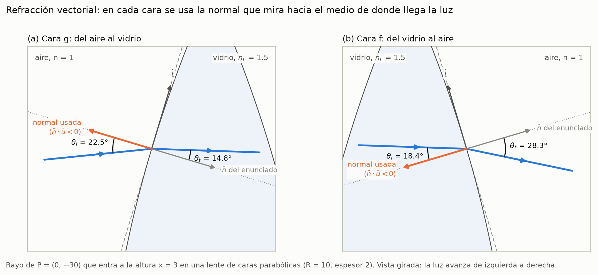

# Deducción del procedimiento vectorial

Actividades 1 y 2 del enunciado y entregable E2. Las convenciones están en las decisiones [0001](decisiones/0001-eje-optico-y-sentido-de-la-luz.md) y [0002](decisiones/0002-normal-y-snell-vectorial.md). Cada paso está implementado en `src/lentes` (sección 10) y el [ejemplo resuelto](../notebooks/01_ejemplo_resuelto.ipynb) lo aplica con números.



## 1. Hipótesis

- **Óptica geométrica.** La longitud de onda es mucho menor que la lente, así que la luz se describe con rayos.
- **Medios homogéneos e isótropos.** Aire ($n = 1$) y vidrio ($n_L$). Dentro de cada medio los rayos son rectas.
- **Problema plano.** Trabajamos en el plano $xy$, una sección de la lente que contiene el eje óptico. El eje óptico es el eje $y$ y la luz viaja en $+y$; $g(x)$ es la cara de entrada y $f(x)$ la de salida.
- **Caras suaves.** $f$ y $g$ son derivables, así que en cada punto hay tangente y normal bien definidas.

## 2. El rayo como recta paramétrica

Un rayo que sale de $\mathbf P_0 = (x_0, y_0)$ con dirección unitaria $\hat{\mathbf u} = (u_x, u_y)$ es

```math
\mathbf L(\lambda) = \mathbf P_0 + \lambda\,\hat{\mathbf u},\qquad \lambda \ge 0,\qquad |\hat{\mathbf u}| = 1 .
```

Como $\hat{\mathbf u}$ es unitario, $\lambda$ es la distancia recorrida desde $\mathbf P_0$. Si el rayo forma un ángulo $\alpha$ con el eje $+y$ (positivo hacia $+x$), entonces $\hat{\mathbf u} = (\sin\alpha, \cos\alpha)$.

## 3. Intersección con una cara curva

El rayo toca la cara $y = s(x)$ (con $s = g$ o $s = f$) cuando el punto $\mathbf L(\lambda)$ cumple la ecuación de la curva:

```math
h(\lambda) \equiv y_0 + \lambda u_y - s(x_0 + \lambda u_x) = 0 .
```

El punto de impacto es $\mathbf Q = \mathbf L(\lambda^\ast)$, donde $\lambda^\ast$ es la **menor raíz positiva** de $h$ que además cae dentro de la lente ($|x_Q| \le a$, la semiapertura). Si no hay raíces positivas, el rayo no toca esa cara.

### Cara parabólica: una ecuación cuadrática

Si $s(x) = y_v + a\,x^2$, con $a = 1/(2R)$ y $R$ el radio de vértice, la condición queda

```math
A\lambda^2 + B\lambda + C = 0,\qquad A = a\,u_x^2,\qquad B = 2a\,x_0u_x - u_y,\qquad C = a\,x_0^2 + y_v - y_0 .
```

- Si $\Delta = B^2 - 4AC < 0$, el rayo no toca la cara.
- En un rayo casi paralelo al eje, $A$ es muy pequeño y la fórmula escolar $\lambda = (-B - \sqrt\Delta)/(2A)$ resta dos números casi iguales: se pierden cifras significativas. Usamos la forma equivalente y estable

  ```math
  q = -\tfrac12\left(B + \operatorname{sgn}(B)\sqrt{\Delta}\right),\qquad \lambda_1 = \frac{q}{A},\qquad \lambda_2 = \frac{C}{q},
  ```

  que además cubre el rayo vertical ($A = 0$ da $\lambda = -C/B$). La prueba `test_formula_estable_frente_a_la_escolar` muestra la diferencia contra un cálculo con 60 cifras.

### Cara cónica: esférica, elíptica o hiperbólica

Una cónica con vértice en $(0, y_v)$, radio de vértice $R$ y constante cónica $k$ cumple $x^2 - 2Rz + (1+k)z^2 = 0$, con $z = y - y_v$ ($k = 0$ es una circunferencia y $k = -1$ una parábola). Al sustituir la recta, con $z_0 = y_0 - y_v$, vuelve a salir una cuadrática:

```math
A = u_x^2 + (1+k)\,u_y^2,\qquad B = 2\left[x_0u_x - Ru_y + (1+k)\,z_0u_y\right],\qquad C = x_0^2 - 2Rz_0 + (1+k)\,z_0^2 .
```

De las raíces se toma la menor positiva que cae en la rama del vértice, que es la cara real (la circunferencia completa, por ejemplo, tiene otra rama que no forma parte de la lente).

### Cara arbitraria: método numérico

Para cualquier $s(x)$ se muestrea $h(\lambda)$ en el tramo donde el rayo cruza la lente, se ubica el primer cambio de signo y se refina con el método de Brent. El método de Newton también serviría, y su derivada dice algo interesante:

```math
h'(\lambda) = u_y - s'(x)\,u_x = \sqrt{1+s'(x)^2}\;\hat{\mathbf u}\cdot\hat{\mathbf n} ,
```

así que Newton falla justo cuando el rayo es tangente a la cara ($\hat{\mathbf u} \perp \hat{\mathbf n}$).

## 4. Vectores tangente y normal

La cara se recorre como $\mathbf r(x) = (x, s(x))$; su derivada $\mathbf r'(x) = (1, s'(x))$ es tangente a la curva. Al normalizarla se obtiene $\hat{\mathbf t}$, y al girarla $90^\circ$, $\hat{\mathbf n}$:

```math
\hat{\mathbf t} = \frac{\left(1,\ s'(x)\right)}{\sqrt{1+s'(x)^2}},\qquad \hat{\mathbf n} = \frac{\left(-s'(x),\ 1\right)}{\sqrt{1+s'(x)^2}},\qquad \hat{\mathbf t}\cdot\hat{\mathbf n} = 0,\qquad |\hat{\mathbf t}| = |\hat{\mathbf n}| = 1 .
```

En el punto de impacto se evalúan en $x = x_Q$.

## 5. El sentido correcto de la normal

$\hat{\mathbf n}$ y $-\hat{\mathbf n}$ son las dos normales a la cara, y la ley de Snell necesita saber cuál usar. La regla es una sola para las dos caras:

> **Se usa la normal que apunta hacia el medio de donde viene la luz**, es decir, la que cumple $\hat{\mathbf n}\cdot\hat{\mathbf u} < 0$. Si $\hat{\mathbf n}\cdot\hat{\mathbf u} > 0$, se cambia $\hat{\mathbf n}\to-\hat{\mathbf n}$.

Con esa elección, $\cos\theta_i = -\hat{\mathbf n}\cdot\hat{\mathbf u} > 0$ siempre. En nuestra lente la $\hat{\mathbf n}$ del enunciado apunta siempre hacia $+y$, y la luz también viaja en $+y$: **en las dos refracciones hay que usar $-\hat{\mathbf n}$**. En la cara $g$ esa normal apunta hacia el aire de abajo y en la cara $f$ hacia el vidrio (figura, paneles a y b).

Si se usara $\hat{\mathbf n}$ sin cambiarle el signo, la fórmula de Snell de la sección siguiente daría resultados absurdos. Por ejemplo, con incidencia normal ($\hat{\mathbf u} = \hat{\mathbf n}$) devolvería $-\hat{\mathbf u}$: un rayo que se da la vuelta.

## 6. Ley de Snell en forma vectorial

**Principio.** Al cruzar la interfaz se conserva la componente tangencial de $n\,\hat{\mathbf u}$. Es la continuidad de la componente tangencial del vector de onda $\mathbf k = n k_0\hat{\mathbf u}$ que imponen las condiciones de frontera de las ecuaciones de Maxwell (también se deduce del principio de Fermat):

```math
n_1\,(\hat{\mathbf u}\cdot\hat{\mathbf t}) = n_2\,(\hat{\mathbf u}_t\cdot\hat{\mathbf t}) \qquad\Longleftrightarrow\qquad n_1\sin\theta_i = n_2\sin\theta_t .
```

**Paso 1.** La igualdad dice que $n_1\hat{\mathbf u} - n_2\hat{\mathbf u}_t$ no tiene componente tangencial, o sea, es paralelo a $\hat{\mathbf n}$. Con $\eta = n_1/n_2$:

```math
\hat{\mathbf u}_t = \eta\,\hat{\mathbf u} + \mu\,\hat{\mathbf n}\qquad\text{para algún número } \mu .
```

**Paso 2.** $\hat{\mathbf u}_t$ es unitario. Usando $\hat{\mathbf u}\cdot\hat{\mathbf n} = -\cos\theta_i$:

```math
1 = \eta^2 - 2\eta\mu\cos\theta_i + \mu^2 \qquad\Longrightarrow\qquad \mu = \eta\cos\theta_i \pm \sqrt{1 - \eta^2\left(1-\cos^2\theta_i\right)} .
```

**Paso 3.** El rayo refractado tiene que pasar al otro lado de la cara: $\hat{\mathbf u}_t\cdot\hat{\mathbf n} = -\eta\cos\theta_i + \mu < 0$, lo que elige el signo menos. Llamando $\cos\theta_t$ a la raíz:

```math
\boxed{\ \hat{\mathbf u}_t = \eta\,\hat{\mathbf u} + \left(\eta\cos\theta_i - \cos\theta_t\right)\hat{\mathbf n},\qquad \cos\theta_i = -\hat{\mathbf n}\cdot\hat{\mathbf u},\qquad \cos\theta_t = \sqrt{1-\eta^2\left(1-\cos^2\theta_i\right)}\ }
```

**Comprobaciones rápidas.** Con incidencia normal ($\hat{\mathbf u} = -\hat{\mathbf n}$) queda $\hat{\mathbf u}_t = \hat{\mathbf u}$; con $n_1 = n_2$, también $\hat{\mathbf u}_t = \hat{\mathbf u}$; y siempre $|\hat{\mathbf u}_t| = 1$.

**Reflexión total interna.** Si $\eta^2\left(1-\cos^2\theta_i\right) > 1$ la raíz no existe: no hay rayo refractado. Solo puede pasar al salir del vidrio ($\eta = 1.5$), cuando $\theta_i > \theta_c = \arcsin(1/1.5) \approx 41.8^\circ$. Entonces el rayo se refleja:

```math
\hat{\mathbf u}_r = \hat{\mathbf u} + 2\cos\theta_i\,\hat{\mathbf n} .
```

## 7. Recorrido completo de un rayo

Para cada cara, en el orden en que la encuentra el rayo:

1. **Impacto.** $\lambda^\ast$ = menor raíz positiva de $h(\lambda)$ dentro de la apertura; $\mathbf Q = \mathbf P_0 + \lambda^\ast\hat{\mathbf u}$.
2. **Normal.** $\hat{\mathbf n}(x_Q)$, cambiándole el signo si $\hat{\mathbf n}\cdot\hat{\mathbf u} > 0$.
3. **Snell.** $\hat{\mathbf u}_t$ con $(n_1, n_2) = (1, n_L)$ al entrar y $(n_L, 1)$ al salir; si la raíz no existe, reflexión total.
4. **Nuevo rayo.** $\mathbf P_0 \leftarrow \mathbf Q$ y $\hat{\mathbf u} \leftarrow \hat{\mathbf u}_t$.

Después de la cara $f$, el rayo emergente es la recta $\mathbf Q_2 + s\,\hat{\mathbf e}$.

## 8. La imagen: cruce de rayos emergentes

Dos rayos emergentes, $\mathbf Q_1 + s\,\hat{\mathbf e}_1$ y $\mathbf Q_2 + t\,\hat{\mathbf e}_2$, se cortan cuando $s\,\hat{\mathbf e}_1 - t\,\hat{\mathbf e}_2 = \mathbf Q_2 - \mathbf Q_1$. Por la regla de Cramer, con $[\mathbf a, \mathbf b] = a_xb_y - a_yb_x$:

```math
s = \frac{[\mathbf Q_2-\mathbf Q_1,\ \hat{\mathbf e}_2]}{[\hat{\mathbf e}_1,\ \hat{\mathbf e}_2]},\qquad t = \frac{[\mathbf Q_2-\mathbf Q_1,\ \hat{\mathbf e}_1]}{[\hat{\mathbf e}_1,\ \hat{\mathbf e}_2]},\qquad \mathbf P' = \mathbf Q_1 + s\,\hat{\mathbf e}_1 .
```

- $s, t > 0$: los rayos se cruzan después de la lente, y la **imagen es real**.
- $s, t < 0$: solo se cruzan sus prolongaciones hacia atrás, y la **imagen es virtual** (objeto dentro de la distancia focal).
- $[\hat{\mathbf e}_1, \hat{\mathbf e}_2] = 0$: los rayos salen paralelos y la imagen está en el infinito (objeto en el foco).

Para un objeto sobre el eje basta un rayo, porque el rayo axial no se desvía: la imagen está donde el rayo emergente cruza el eje, en $y' = y_Q - x_Q\,e_y/e_x$.

**En una lente real, la "imagen" depende de qué rayos se elijan.** Rayos que entran a distintas alturas cruzan el eje en puntos distintos: eso es la aberración esférica. La imagen paraxial es el límite cuando los rayos se acercan al eje; las actividades 4 y 5 estudian cuánto se aparta el resto.

## 9. Comprobación con calculadora: Snell con ángulos

Para un rayo que sube por una cara $y = s(x)$, todo se puede escribir con ángulos medidos desde el eje $+y$ (positivos hacia $+x$). Si $\varphi = \arctan s'(x_Q)$ es la inclinación de la cara, la normal que apunta hacia $+y$ forma el ángulo $-\varphi$ con el eje, y entonces

```math
\theta_i = \alpha + \varphi,\qquad n_1\sin\theta_i = n_2\sin\theta_t,\qquad \alpha' = \theta_t - \varphi .
```

Es la misma física que la forma vectorial, calculada por otro camino. El [ejemplo resuelto](../notebooks/01_ejemplo_resuelto.ipynb) usa esta versión, con la intersección cuadrática, y la compara con el trazador vectorial: coinciden hasta la precisión de la máquina ($\sim 10^{-16}$). La simulación usa la forma vectorial porque no necesita que el rayo suba, maneja la reflexión total y se extiende tal cual a tres dimensiones.

## 10. Dónde está cada paso en el código

| Paso | Función | Prueba |
|---|---|---|
| Recta, intersección numérica | `lentes.trazado.interseccion` | `tests/test_trazado.py`, `tests/test_exacta.py` |
| Intersección exacta (cónicas) | `lentes.trazado.interseccion_exacta`, `raices_cuadratica` | `tests/test_exacta.py` |
| Tangente y normal | `Superficie.tangente`, `Superficie.normal` | `tests/test_superficies.py` |
| Sentido de la normal y Snell vectorial | `lentes.trazado.refractar`, `detalle_refraccion` | `tests/test_refraccion.py` |
| Recorrido completo | `lentes.trazado.trazar` | `tests/test_trazado.py` |
| Imagen por cruce de rayos | `imagen_de_dos_rayos`, `interseccion_rectas` | `tests/test_trazado.py` |
| Versión con calculadora | `lentes.a_mano` | `tests/test_a_mano.py` |

## Referencias

- E. Hecht, *Optics*, 5.ª ed., Pearson, 2017. Capítulos 4 (propagación de la luz: reflexión y refracción) y 5 (óptica geométrica).
- M. Born y E. Wolf, *Principles of Optics*, 7.ª ed., Cambridge University Press, 1999.
- A. S. Glassner (ed.), *An Introduction to Ray Tracing*, Academic Press, 1989 (forma vectorial de la refracción).
- R. P. Brent, *Algorithms for Minimization without Derivatives*, Prentice-Hall, 1973 (método de Brent para raíces).
- W. H. Press, S. A. Teukolsky, W. T. Vetterling y B. P. Flannery, *Numerical Recipes*, 3.ª ed., Cambridge University Press, 2007, sección 5.6 (fórmula cuadrática estable).
