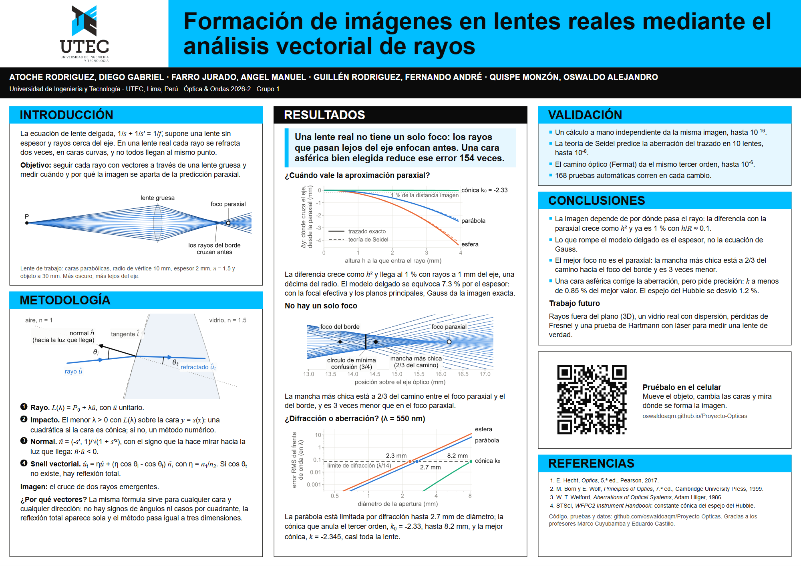

# Póster

Póster A0 horizontal (1189 x 841 mm) sobre la plantilla de UTEC que compartieron los profesores ([decisión 0008](../docs/decisiones/0008-poster-en-html-a-tamano-real.md)).



| Archivo | Qué es |
|---|---|
| `poster.html` | La fuente: textos, orden y diseño, en milímetros y puntos. |
| `generar_poster.py` | Dibuja las figuras del póster y lo exporta. |
| `figuras/` | Figuras del póster en SVG, generadas por el script. No se editan a mano. |
| `recursos/logo-utec.png` | El logo de UTEC, tomado de la plantilla. |
| `poster.pdf` | El póster para imprimir. |
| `poster.png` | Vista previa. |

## Regenerar

Desde la raíz del repositorio:

```bash
python poster/generar_poster.py --figuras   # solo las figuras
python poster/generar_poster.py             # figuras, poster.pdf y poster.png
```

Exportar el PDF necesita [Playwright](https://playwright.dev/python/) (una vez: `pip install playwright` y `playwright install chromium`). Sin Playwright: abrir `poster.html` en Chrome o Edge, Imprimir, Destino "Guardar como PDF", Márgenes "Ninguno" y con "Gráficos de fondo" activado. El tamaño de hoja lo fija el archivo.

## Revisar antes de imprimir

- Abrir `poster.pdf`: tiene que ser una sola página A0 y no debe faltar ni cortarse ningún texto.
- Imprimir una prueba en A4 (un cuarto del tamaño) y leerla a 50 cm: equivale a leer el A0 a 2 m.
- Escanear el QR de la prueba impresa con un iPhone y con un Android.
- Contar las palabras (entre 600 y 800) y que cada color signifique una sola cosa.

## De dónde sale cada número

| En el póster | Fuente |
|---|---|
| 1 % con rayos a 1 mm del eje; modelo delgado 7.3 %; planos principales | [notebook 02](../notebooks/02_aberraciones.ipynb), sección 2 |
| Mancha más chica a 2/3 y 3 veces menor | [notebook 02](../notebooks/02_aberraciones.ipynb), sección 3 |
| Cónica $k_0 = -2.33$ y 154 veces menos en el borde | [notebook 02](../notebooks/02_aberraciones.ipynb), sección 4 |
| 2.3, 2.7 y 8.2 mm; mejor cónica $k = -2.345$; tolerancia de 0.85 % | [notebook 04](../notebooks/04_frente_de_onda.ipynb), secciones 3 y 5 |
| Validación ($10^{-16}$, $10^{-8}$, $10^{-6}$, 168 pruebas) | notebook 01, notebook 02 (sección 1), notebook 04 (sección 1) y `pytest` |
